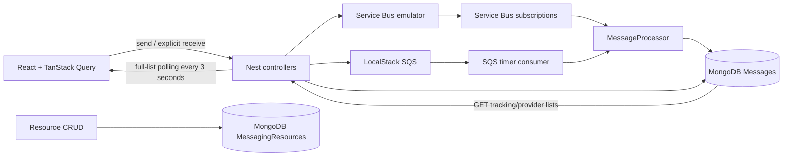

# Emulator Monitor — Phase 1 analysis

Review date: 2026-10-15. Baseline commit: `22ae10f`. Scope: the whole workspace, including application code, shared types, tests, Nx/build configuration, Compose, CI, and documentation. Phase 1 changed no application source or configuration. Phase 2 step 1 is complete; see its verification record below. Subsequent user-requested unified messaging work is recorded below; the numbered roadmap still tracks the original step-by-step sequence.

## Method and confidence

Graphify detected 168 files (163 code/config, five documents), approximately 549,169 words, with no sensitive files skipped. Most of that word count is the checked-in Yarn distribution. Structural extraction initially produced 6,085 nodes; excluding its 4,828 vendor nodes yielded an application/document graph of **1,275 nodes, 2,650 edges, and 63 communities**. Five documents received semantic extraction. The graph is available in `graphify-out/graph.json`, `graphify-out/graph.html`, and `graphify-out/GRAPH_REPORT.md`.

Graph vocabulary query: `service bus sqs message tracking processor polling config schema query test health`. The traversal returned 383 nodes and was truncated to a 2,200-token display budget; direct source review supplied the detailed findings below. The graph is a navigation aid, not proof that a runtime path succeeds. Thirteen files yielded no AST symbols, including some test/config files, so these were inspected directly. The health diagnostic reports one self-loop, six exact duplicate edges, and 90 same-endpoint edge occurrences collapsed by the undirected graph. There were no missing/dangling endpoints. See `graphify-out/GRAPH_HEALTH.txt`.

Graphify's launcher failed, but its installed Python runtime worked. No external LLM API was used. Host-session token usage is unavailable; the semantic fragment's 3,553 input / 3,120 output counts are estimates, not measured usage. Generated zero API counters must not be read as zero session cost. `graphify-out/` is newly generated and untracked; `.gitignore` was not changed.

Verification limits:

- `node .yarn/releases/yarn-1.22.22.cjs nx show projects` failed: Nx modules are not installed in this checkout (`node_modules` is absent). Lint, typecheck, tests, builds, inferred target configuration, and numerical coverage were therefore **not verified**. This is an environment limitation, not evidence that those checks fail in CI.
- `docker compose config --quiet` completed without a reported configuration error; `docker compose ps` failed because access to the Docker Desktop daemon was denied. Containers were not started or mutated. Emulator interoperability, reconnect behavior, and load behavior remain unexecuted.
- Findings are source-confirmed unless explicitly described as a risk or a runtime check still needed. Severity assumes a local development dashboard: **high** means core flows fail or tracking can materially misrepresent/lossily handle messages; **med** means reliability, scaling, or local exposure problems; **low** means narrower DX/maintainability issues.
- Efforts include focused implementation and regression tests, assuming dependencies are available. Larger fixes are split into independently useful roadmap steps of at most approximately one hour. They are estimates, not runtime measurements.

## 1. Architecture and data flow

| Nx project | Responsibility and boundary | Evidence |
| --- | --- | --- |
| `backend` | NestJS API and both active consumers in one process; Webpack build, explicit serve/test targets | [apps/backend/project.json:1-20](C:/Users/burak/source/repos/emulator-monitor/apps/backend/project.json:1), [apps/backend/project.json:46-70](C:/Users/burak/source/repos/emulator-monitor/apps/backend/project.json:46) |
| `@e2e-monitor/monitor` | React/Vite SPA; route-local feature components, TanStack Query server state, local React state for forms/selections | [apps/monitor/package.json:1-24](C:/Users/burak/source/repos/emulator-monitor/apps/monitor/package.json:1), [apps/monitor/src/app/app.tsx:10-55](C:/Users/burak/source/repos/emulator-monitor/apps/monitor/src/app/app.tsx:10), [apps/monitor/src/app/providers.tsx:20-65](C:/Users/burak/source/repos/emulator-monitor/apps/monitor/src/app/providers.tsx:20) |
| `monitor-e2e` | Playwright Chromium smoke tests; depends on monitor, starts Vite, mocks tracking requests | [apps/monitor-e2e/project.json:1-15](C:/Users/burak/source/repos/emulator-monitor/apps/monitor-e2e/project.json:1), [apps/monitor-e2e/playwright.config.ts:38-50](C:/Users/burak/source/repos/emulator-monitor/apps/monitor-e2e/playwright.config.ts:38), [apps/monitor-e2e/src/smoke.spec.ts:4-26](C:/Users/burak/source/repos/emulator-monitor/apps/monitor-e2e/src/smoke.spec.ts:4) |
| `@e2e-monitor/entities` | Small browser-safe TypeScript interface package; no runtime SDK/filesystem imports | [libs/shared/entities/package.json:1-19](C:/Users/burak/source/repos/emulator-monitor/libs/shared/entities/package.json:1), [libs/shared/entities/src/lib/entities.ts:1-19](C:/Users/burak/source/repos/emulator-monitor/libs/shared/entities/src/lib/entities.ts:1) |

Nest composition is reasonably separated: `AppModule` imports configuration, common services, tracking persistence, resources, provider modules, and health. Provider SDK clients are injected through symbol tokens and factories; both consumers use `MessageService` and the shared `MessageProcessor`. Mongoose has a named `MessageTrackingDb` connection and feature-level model registration. There is no observed circular module dependency. `CommonModule` is global and is also explicitly imported; `AppLogger` is transient, so per-consumer context mutation is appropriate ([apps/backend/src/app/app.module.ts:19-90](C:/Users/burak/source/repos/emulator-monitor/apps/backend/src/app/app.module.ts:19), [apps/backend/src/app/service-bus/service-bus.module.ts:12-31](C:/Users/burak/source/repos/emulator-monitor/apps/backend/src/app/service-bus/service-bus.module.ts:12), [apps/backend/src/app/aws-sqs/aws-sqs.module.ts:11-31](C:/Users/burak/source/repos/emulator-monitor/apps/backend/src/app/aws-sqs/aws-sqs.module.ts:11), [apps/backend/src/app/messages/messages.module.ts:8-20](C:/Users/burak/source/repos/emulator-monitor/apps/backend/src/app/messages/messages.module.ts:8), [apps/backend/src/app/common/common.module.ts:6-12](C:/Users/burak/source/repos/emulator-monitor/apps/backend/src/app/common/common.module.ts:6), [apps/backend/src/app/common/logger.service.ts:4-9](C:/Users/burak/source/repos/emulator-monitor/apps/backend/src/app/common/logger.service.ts:4)).



This dashboard is an **active competing consumer**, not just a passive queue observer: startup subscribes to all configured Service Bus queues/subscriptions; SQS polls the default queue and deletes complete messages. Explicit receive endpoints compete with those workers. The browser lists MongoDB tracking history, not broker queue contents. Resource CRUD stores metadata; it does not provision queues/topics or reconfigure worker subscriptions ([apps/backend/src/app/service-bus/service-bus.worker.ts:30-49](C:/Users/burak/source/repos/emulator-monitor/apps/backend/src/app/service-bus/service-bus.worker.ts:30), [apps/backend/src/app/aws-sqs/aws-sqs.service.ts:184-219](C:/Users/burak/source/repos/emulator-monitor/apps/backend/src/app/aws-sqs/aws-sqs.service.ts:184), [apps/backend/src/app/aws-sqs/aws-sqs.service.ts:238-309](C:/Users/burak/source/repos/emulator-monitor/apps/backend/src/app/aws-sqs/aws-sqs.service.ts:238), [apps/backend/src/app/message-resources/message-resources.service.ts:15-37](C:/Users/burak/source/repos/emulator-monitor/apps/backend/src/app/message-resources/message-resources.service.ts:15)).

**F01 — med — Boundary rules and shared contracts do not prevent drift.**

Evidence: [eslint.config.mjs:18-27](C:/Users/burak/source/repos/emulator-monitor/eslint.config.mjs:18) allows every tag to depend on every tag; [apps/backend/project.json:6](C:/Users/burak/source/repos/emulator-monitor/apps/backend/project.json:6) has no tags. The shared interface requires identity/body/dates, whereas frontend Zod makes most fields optional and feature pages cast to the shared type; backend defines its own schema/type. Dates are objects after frontend coercion but strings on the wire ([libs/shared/entities/src/lib/entities.ts:7-19](C:/Users/burak/source/repos/emulator-monitor/libs/shared/entities/src/lib/entities.ts:7), [apps/monitor/src/app/lib/schemas.ts:35-58](C:/Users/burak/source/repos/emulator-monitor/apps/monitor/src/app/lib/schemas.ts:35), [apps/monitor/src/app/features/messages/index.tsx:63](C:/Users/burak/source/repos/emulator-monitor/apps/monitor/src/app/features/messages/index.tsx:63), [apps/backend/src/app/messages/message.schema.ts:20-52](C:/Users/burak/source/repos/emulator-monitor/apps/backend/src/app/messages/message.schema.ts:20)). Fix: first make the tracking response contract strict and remove unsafe assertions; distinguish wire and parsed dates, then add meaningful application/shared tags. Keep SDK-specific types in backend. Effort: 2-3 hours, split across contract and boundary steps.

## 2. Correctness and robustness

**F02 — high — Tracking identity merges distinct Service Bus deliveries.**

Evidence: the unique index and all lookup/update/upsert predicates use only `{emulatorType, messageId}` ([apps/backend/src/app/messages/message.schema.ts:58-61](C:/Users/burak/source/repos/emulator-monitor/apps/backend/src/app/messages/message.schema.ts:58), [apps/backend/src/app/messages/messages.service.ts:45-70](C:/Users/burak/source/repos/emulator-monitor/apps/backend/src/app/messages/messages.service.ts:45), [apps/backend/src/app/messages/messages.service.ts:93-140](C:/Users/burak/source/repos/emulator-monitor/apps/backend/src/app/messages/messages.service.ts:93)). Workers consume multiple queues and topic subscriptions, but store entity identity only as a non-key `queue` value ([apps/backend/src/app/service-bus/service-bus.worker.ts:89-103](C:/Users/burak/source/repos/emulator-monitor/apps/backend/src/app/service-bus/service-bus.worker.ts:89), [apps/backend/src/app/service-bus/service-bus.worker.ts:180-205](C:/Users/burak/source/repos/emulator-monitor/apps/backend/src/app/service-bus/service-bus.worker.ts:180)). `application-events` has two subscriptions ([config/servicebus-config.json:22-39](C:/Users/burak/source/repos/emulator-monitor/config/servicebus-config.json:22)). A single topic message therefore shares one document across both deliveries; first insert wins for queue metadata and later updates overwrite the receiver/outcome. Reusing an ID in two queues has the same problem; same-queue redeliveries erase attempt history. Fix: retain logical message identity but create delivery records keyed by provider + namespace/account + entity/subscription + broker ID, and append attempt/outcome information. Use that key through all mutations. Migrate indexes explicitly with collision checks; do not automatically drop old indexes at startup. Effort: 4-6 hours in additive schema, worker, query, and migration slices.

**F03 — high — Tracking says received before settlement succeeds and loses post-settlement failures.**

Evidence: processor calls `markMessageReceived` before its delay and broker action; the helper sets `status: received`. Failed initial tracking writes are swallowed, settlement errors rethrow, and failed final outcome writes are only logged ([apps/backend/src/app/common/message-processor.ts:74-132](C:/Users/burak/source/repos/emulator-monitor/apps/backend/src/app/common/message-processor.ts:74), [apps/backend/src/app/messages/messages.service.ts:93-111](C:/Users/burak/source/repos/emulator-monitor/apps/backend/src/app/messages/messages.service.ts:93)). Explicit receive paths also mark received before complete/delete ([apps/backend/src/app/service-bus/service-bus.service.ts:122-135](C:/Users/burak/source/repos/emulator-monitor/apps/backend/src/app/service-bus/service-bus.service.ts:122), [apps/backend/src/app/aws-sqs/aws-sqs.service.ts:130-146](C:/Users/burak/source/repos/emulator-monitor/apps/backend/src/app/aws-sqs/aws-sqs.service.ts:130)). A delete/complete failure leaves a received-looking record; a successful settlement followed by DB failure cannot be repaired through broker redelivery. Abandon/defer also become `received` without a distinct settled/retry state. Fix: use processing/settlement/failed or pending-outcome states, preserve the old state on action failure, and persist repairable outcome intents with a bounded reconciler. An immediate first fix can move the received update after successful settlement; this does not provide cross-system atomicity. Effort: 1 hour for ordering, 3-5 additional one-hour slices for durable reconciliation/state semantics.

**F04 — high — Send and tracking operations have inconsistent failure windows.**

Evidence: Service Bus inserts tracking before send and deletes it for every send exception ([apps/backend/src/app/service-bus/service-bus.service.ts:51-66](C:/Users/burak/source/repos/emulator-monitor/apps/backend/src/app/service-bus/service-bus.service.ts:51)). An ambiguous timeout can mean the broker accepted the send; removing tracking discards the intent, and cleanup failure masks the original send error. Reusing an already tracked message ID fails in Mongo before Service Bus duplicate detection can act. SQS sends first, then does a plain insert and logs/ignores DB failure ([apps/backend/src/app/aws-sqs/aws-sqs.service.ts:70-98](C:/Users/burak/source/repos/emulator-monitor/apps/backend/src/app/aws-sqs/aws-sqs.service.ts:70)). Its worker can upsert the record first, causing a duplicate-key insert; `$setOnInsert` preserves worker-generated `sentAt`/sender metadata. Fix: use idempotent merge/upsert for SQS send metadata without regressing worker outcomes; preserve Service Bus failed/unknown send intent and original exception. Define API behavior for accepted-but-untracked messages and provide reconciliation rather than claiming atomic delivery. Effort: 2-4 hours in separate provider and reconciliation slices.

**F05 — high — SQS dead-letter is a no-op presented as a completed outcome.**

Evidence: `deadletter` and `abandon` execute no SDK operation; only `complete` deletes and `defer` sets visibility to 300 seconds ([apps/backend/src/app/aws-sqs/aws-sqs.service.ts:285-309](C:/Users/burak/source/repos/emulator-monitor/apps/backend/src/app/aws-sqs/aws-sqs.service.ts:285)). Queue creation sets no redrive policy ([apps/backend/src/app/aws-sqs/aws-sqs.service.ts:360-385](C:/Users/burak/source/repos/emulator-monitor/apps/backend/src/app/aws-sqs/aws-sqs.service.ts:360)). The processor nevertheless writes `deadletter`, and the UI labels those documents “DLQ Messages” ([apps/backend/src/app/common/message-processor.ts:100-129](C:/Users/burak/source/repos/emulator-monitor/apps/backend/src/app/common/message-processor.ts:100), [apps/monitor/src/app/features/aws-sqs/components/StatisticsCards.tsx:34-40](C:/Users/burak/source/repos/emulator-monitor/apps/monitor/src/app/features/aws-sqs/components/StatisticsCards.tsx:34)). These messages can recur forever on a newly created standard queue. Fix: immediately reject/disable unsupported dead-letter actions or label them as requested; separately provision a DLQ/redrive policy and distinguish requested outcome from observed DLQ placement. Effort: 45 minutes for honest capability handling; 1 hour each for provisioning and integration verification.

**F06 — high — Azure send picker selects invalid entities and transmits UI prefixes.**

Evidence: the sheet hardcodes `test-queue`/`test-topic`, sets option values to `queue:<name>` / `topic:<name>`, and passes the selected string as `queue` ([apps/monitor/src/app/features/azure-sb/components/SendMessageSheet.tsx:30-50](C:/Users/burak/source/repos/emulator-monitor/apps/monitor/src/app/features/azure-sb/components/SendMessageSheet.tsx:30), [apps/monitor/src/app/features/azure-sb/components/SendMessageSheet.tsx:92-99](C:/Users/burak/source/repos/emulator-monitor/apps/monitor/src/app/features/azure-sb/components/SendMessageSheet.tsx:92), [apps/monitor/src/app/features/azure-sb/components/SendMessageSheet.tsx:171-195](C:/Users/burak/source/repos/emulator-monitor/apps/monitor/src/app/features/azure-sb/components/SendMessageSheet.tsx:171)). Backend sends to that exact string ([apps/backend/src/app/service-bus/service-bus.service.ts:33-35](C:/Users/burak/source/repos/emulator-monitor/apps/backend/src/app/service-bus/service-bus.service.ts:33), [apps/backend/src/app/service-bus/service-bus.service.ts:175-183](C:/Users/burak/source/repos/emulator-monitor/apps/backend/src/app/service-bus/service-bus.service.ts:175)). Real config has `orders-queue`, `notifications-queue`, `errm-policy-triggered`, `system-messages`, and `application-events` ([config/servicebus-config.json:6-67](C:/Users/burak/source/repos/emulator-monitor/config/servicebus-config.json:6)). Fix: populate from the existing config API and send the raw broker entity name, with an explicit default option. Test both queue and topic selection. Effort: 45-60 minutes.

**F07 — high — SQS UI bypasses queue resolution and custom queues are never consumed.**

Evidence: UI constructs `http://localhost:4566/000000000000/<name>` rather than using configured endpoint/account information ([apps/monitor/src/app/features/aws-sqs/components/SendMessageSheet.tsx:66-82](C:/Users/burak/source/repos/emulator-monitor/apps/monitor/src/app/features/aws-sqs/components/SendMessageSheet.tsx:66)). Backend returns full URLs unchanged and therefore bypasses get/create; retry takes the same URL again ([apps/backend/src/app/aws-sqs/aws-sqs.service.ts:326-357](C:/Users/burak/source/repos/emulator-monitor/apps/backend/src/app/aws-sqs/aws-sqs.service.ts:326), [apps/backend/src/app/aws-sqs/aws-sqs.service.ts:452-455](C:/Users/burak/source/repos/emulator-monitor/apps/backend/src/app/aws-sqs/aws-sqs.service.ts:452), [apps/backend/src/app/aws-sqs/aws-sqs.service.ts:480-483](C:/Users/burak/source/repos/emulator-monitor/apps/backend/src/app/aws-sqs/aws-sqs.service.ts:480)). Startup polls only `awsSqsQueueName` ([apps/backend/src/app/aws-sqs/aws-sqs.service.ts:184-188](C:/Users/burak/source/repos/emulator-monitor/apps/backend/src/app/aws-sqs/aws-sqs.service.ts:184)); saved AWS resources have no worker registration path. Thus a custom resource can remain uncreated or unprocessed. Fix: accept a validated queue name separately and resolve it server-side; start a managed poller for supported custom queues or explicitly restrict the UI to the monitored default. Effort: 1 hour for name resolution; 1 hour for an honest default-only restriction, or multiple later worker-management slices.

**F08 — med — SQS manual receive requests a batch but handles one message.**

Evidence: DTO allows 1-10 and the SDK gets that number, but only `Messages[0]` is returned/tracked/deleted ([apps/backend/src/app/aws-sqs/dto/receive-sqs-message.dto.ts:20-24](C:/Users/burak/source/repos/emulator-monitor/apps/backend/src/app/aws-sqs/dto/receive-sqs-message.dto.ts:20), [apps/backend/src/app/aws-sqs/aws-sqs.service.ts:112-161](C:/Users/burak/source/repos/emulator-monitor/apps/backend/src/app/aws-sqs/aws-sqs.service.ts:112)). Remaining messages become invisible until visibility expiry. Direct receives of external messages only attempt an update; they can delete a message with no tracking record. Service Bus direct receive has the same missing-record problem ([apps/backend/src/app/service-bus/service-bus.service.ts:122-135](C:/Users/burak/source/repos/emulator-monitor/apps/backend/src/app/service-bus/service-bus.service.ts:122)). Fix: cap the single-message contract at one, or return/process the whole batch; ensure external tracking before settlement. Effort: 30 minutes to cap; 45-60 minutes per provider for external-message tracking.

**F09 — med — Recovery is incomplete around initialization, stale queue URLs, and readiness.**

Evidence: Service Bus config/bootstrap/subscription failures are caught and only logged; no application resubscribe loop exists ([apps/backend/src/app/service-bus/service-bus.worker.ts:30-52](C:/Users/burak/source/repos/emulator-monitor/apps/backend/src/app/service-bus/service-bus.worker.ts:30), [apps/backend/src/app/service-bus/service-bus.worker.ts:123-161](C:/Users/burak/source/repos/emulator-monitor/apps/backend/src/app/service-bus/service-bus.worker.ts:123), [apps/backend/src/app/service-bus/service-bus.worker.ts:209-212](C:/Users/burak/source/repos/emulator-monitor/apps/backend/src/app/service-bus/service-bus.worker.ts:209)). Azure SDK retries are configured, so it would be wrong to claim there are no retries ([apps/backend/src/app/service-bus/service-bus.module.ts:19-23](C:/Users/burak/source/repos/emulator-monitor/apps/backend/src/app/service-bus/service-bus.module.ts:19)); distinguish SDK transient retries from a receiver never registered successfully. SQS prevents overlapping polls and drains tasks on shutdown (good), but its background receive does not invalidate a cached URL on queue deletion; only explicit send/receive error handlers do. Polling retries at fixed five-second intervals, one message at a time, without application backoff ([apps/backend/src/app/aws-sqs/aws-sqs.service.ts:194-247](C:/Users/burak/source/repos/emulator-monitor/apps/backend/src/app/aws-sqs/aws-sqs.service.ts:194), [apps/backend/src/app/aws-sqs/aws-sqs.service.ts:269-283](C:/Users/burak/source/repos/emulator-monitor/apps/backend/src/app/aws-sqs/aws-sqs.service.ts:269), [apps/backend/src/app/aws-sqs/aws-sqs.service.ts:331-338](C:/Users/burak/source/repos/emulator-monitor/apps/backend/src/app/aws-sqs/aws-sqs.service.ts:331)). Health pings the default entities, not worker registration ([apps/backend/src/app/health/health.controller.ts:44-51](C:/Users/burak/source/repos/emulator-monitor/apps/backend/src/app/health/health.controller.ts:44)). Fix: invalidate missing queues on background receive; track worker registration/last success in readiness; add bounded jittered resubscription for failed registration and explicit request timeouts/abort for shutdown. Verify stop/restart against both emulators. Effort: 3-4 hours in one-hour slices.

**F10 — med — Ordering, poison-message handling, and deferred/DLQ inspection are incomplete.**

Evidence: Azure sets five concurrent calls and processor delay is actually 0-4,999 ms, despite comments saying 0-2 seconds ([apps/backend/src/app/service-bus/service-bus.worker.ts:130-154](C:/Users/burak/source/repos/emulator-monitor/apps/backend/src/app/service-bus/service-bus.worker.ts:130), [apps/backend/src/app/common/message-processor.ts:34-39](C:/Users/burak/source/repos/emulator-monitor/apps/backend/src/app/common/message-processor.ts:34)). No session-based processing is present. SQS receives only one every five seconds and does not request broker sent timestamp/receive-count system attributes ([apps/backend/src/app/aws-sqs/aws-sqs.service.ts:242-267](C:/Users/burak/source/repos/emulator-monitor/apps/backend/src/app/aws-sqs/aws-sqs.service.ts:242)); external `sentAt` becomes local receipt time. FIFO fields are accepted by send DTO but auto-create lacks FIFO attributes ([apps/backend/src/app/aws-sqs/dto/send-sqs-message.dto.ts:32-38](C:/Users/burak/source/repos/emulator-monitor/apps/backend/src/app/aws-sqs/dto/send-sqs-message.dto.ts:32), [apps/backend/src/app/aws-sqs/aws-sqs.service.ts:362](C:/Users/burak/source/repos/emulator-monitor/apps/backend/src/app/aws-sqs/aws-sqs.service.ts:362)). Azure messages lacking IDs are completed and discarded from tracking; invalid disposition strings fail normalization repeatedly ([apps/backend/src/app/service-bus/service-bus.worker.ts:172-177](C:/Users/burak/source/repos/emulator-monitor/apps/backend/src/app/service-bus/service-bus.worker.ts:172), [apps/backend/src/app/common/message-processor.ts:46-52](C:/Users/burak/source/repos/emulator-monitor/apps/backend/src/app/common/message-processor.ts:46)). Deferred sequence numbers and delivery counts are not stored, and receivers have no deferred/DLQ retrieval path ([apps/backend/src/app/service-bus/service-bus.worker.ts:180-205](C:/Users/burak/source/repos/emulator-monitor/apps/backend/src/app/service-bus/service-bus.worker.ts:180), [apps/backend/src/app/service-bus/service-bus.worker.ts:235-251](C:/Users/burak/source/repos/emulator-monitor/apps/backend/src/app/service-bus/service-bus.worker.ts:235), [apps/backend/src/app/messages/message.schema.ts:20-52](C:/Users/burak/source/repos/emulator-monitor/apps/backend/src/app/messages/message.schema.ts:20)). Fix: document unordered simulation; request/store broker timestamps/counts, quarantine malformed messages, explicitly reject unsupported FIFO auto-create, and expose deferred sequence metadata before adding a recovery endpoint. Relabel DLQ cards as tracked outcomes until broker inspection exists. Effort: 4-6 one-hour slices; full ordering/session support is a separate feature.

## 3. Backend quality

**F11 — med — Unbounded list endpoints and missing sort indexes scale with total history.**

Evidence: tracking and provider lists return all records including bodies, sorting only by `sentAt`, while the only explicit tracking index is identity ([apps/backend/src/app/messages/messages.service.ts:27-38](C:/Users/burak/source/repos/emulator-monitor/apps/backend/src/app/messages/messages.service.ts:27), [apps/backend/src/app/messages/message.schema.ts:58-61](C:/Users/burak/source/repos/emulator-monitor/apps/backend/src/app/messages/message.schema.ts:58)). Resource lists are also unbounded ([apps/backend/src/app/message-resources/message-resources.service.ts:15-16](C:/Users/burak/source/repos/emulator-monitor/apps/backend/src/app/message-resources/message-resources.service.ts:15)). React polls full lists every three seconds. `lean()` is already used, which helps allocation but does not bound work. Fix: additive validated `limit`/cursor endpoint with deterministic `{sentAt, _id}` ordering and matching global/provider indexes; summary/list projections should omit full bodies. Fetch bodies on demand and move filtering/statistics to API before switching the UI. Add opt-in retention/export rather than silently deleting local history. Effort: 4-6 hours split API/index, UI, filters/counts, detail loading, and retention slices.

**F12 — med — Invalid/missing IDs and duplicates produce inconsistent HTTP responses.**

Evidence: tracking controllers pass unvalidated ID strings into Mongoose; find/update can return null under a `success: true` envelope, delete missing records succeeds, and duplicate-key/CastError receive the catch-all 500 mapping ([apps/backend/src/app/messages/messages.controller.ts:52-99](C:/Users/burak/source/repos/emulator-monitor/apps/backend/src/app/messages/messages.controller.ts:52), [apps/backend/src/app/messages/messages.service.ts:41-42](C:/Users/burak/source/repos/emulator-monitor/apps/backend/src/app/messages/messages.service.ts:41), [apps/backend/src/app/messages/messages.service.ts:73-87](C:/Users/burak/source/repos/emulator-monitor/apps/backend/src/app/messages/messages.service.ts:73), [apps/backend/src/app/common/http-exception.filter.ts:39-59](C:/Users/burak/source/repos/emulator-monitor/apps/backend/src/app/common/http-exception.filter.ts:39)). Resource operations already use 404 for missing IDs, giving a useful precedent. Fix: validate ObjectId route parameters, return 404 for absent tracking detail/update, map duplicates to 409, and explicitly document idempotent delete behavior. Effort: 45-60 minutes.

**F13 — med — DTO validation is a good baseline but cross-field, nested, and update constraints are missing.**

Evidence: global whitelist/transform/forbid-extra-fields is enabled ([apps/backend/src/main.ts:43-52](C:/Users/burak/source/repos/emulator-monitor/apps/backend/src/main.ts:43)). SQS attributes are checked only as an object, Azure application properties are unrestricted values, and entity/sender strings are not bounded ([apps/backend/src/app/aws-sqs/dto/send-sqs-message.dto.ts:24-42](C:/Users/burak/source/repos/emulator-monitor/apps/backend/src/app/aws-sqs/dto/send-sqs-message.dto.ts:24), [apps/backend/src/app/service-bus/dto/send-service-bus-message.dto.ts:18-53](C:/Users/burak/source/repos/emulator-monitor/apps/backend/src/app/service-bus/dto/send-service-bus-message.dto.ts:18)). Receive DTO permits a topic without subscription or queue plus topic and silently falls back/chooses queue ([apps/backend/src/app/service-bus/dto/receive-service-bus-message.dto.ts:3-18](C:/Users/burak/source/repos/emulator-monitor/apps/backend/src/app/service-bus/dto/receive-service-bus-message.dto.ts:3), [apps/backend/src/app/service-bus/service-bus.service.ts:93-105](C:/Users/burak/source/repos/emulator-monitor/apps/backend/src/app/service-bus/service-bus.service.ts:93)). Mongoose update/upsert options omit `runValidators`; resource name can be updated to empty ([apps/backend/src/app/messages/messages.service.ts:67-78](C:/Users/burak/source/repos/emulator-monitor/apps/backend/src/app/messages/messages.service.ts:67), [apps/backend/src/app/message-resources/message-resources.service.ts:25-26](C:/Users/burak/source/repos/emulator-monitor/apps/backend/src/app/message-resources/message-resources.service.ts:25), [apps/backend/src/app/message-resources/dto/update-message.dto.ts:4-7](C:/Users/burak/source/repos/emulator-monitor/apps/backend/src/app/message-resources/dto/update-message.dto.ts:4)). Fix: nested provider-compatible attribute DTOs with limits, explicit receive-target exclusivity/pairing, bounded names, and validated updates. Keep each provider's accepted values explicit. Effort: three 45-60 minute slices.

**F14 — med — Payload limits disagree across HTTP, DTOs, and broker encoding.**

Evidence: both send DTOs cap string length at 262,144; bootstrap uses the default Express JSON parser without a configured limit ([apps/backend/src/app/aws-sqs/dto/send-sqs-message.dto.ts:19-22](C:/Users/burak/source/repos/emulator-monitor/apps/backend/src/app/aws-sqs/dto/send-sqs-message.dto.ts:19), [apps/backend/src/app/service-bus/dto/send-service-bus-message.dto.ts:22-25](C:/Users/burak/source/repos/emulator-monitor/apps/backend/src/app/service-bus/dto/send-service-bus-message.dto.ts:22), [apps/backend/src/main.ts:16-18](C:/Users/burak/source/repos/emulator-monitor/apps/backend/src/main.ts:16)). Express's default is 100 KB, so a body allowed by DTO policy can be rejected before validation. Character count also does not bound UTF-8 bytes or attribute overhead. Both providers parse/re-serialize arbitrary JSON, altering original payload representation ([apps/backend/src/app/service-bus/service-bus.service.ts:37-53](C:/Users/burak/source/repos/emulator-monitor/apps/backend/src/app/service-bus/service-bus.service.ts:37), [apps/backend/src/app/aws-sqs/aws-sqs.service.ts:52-57](C:/Users/burak/source/repos/emulator-monitor/apps/backend/src/app/aws-sqs/aws-sqs.service.ts:52)). Fix: define an intentional local byte limit, align JSON envelope and field validation, preserve payload text unless typed JSON encoding is requested, and test multibyte data plus boundary sizes. The chosen limit should match supported emulator behavior rather than an assumed cloud maximum. Effort: 1 hour for limits; 1 hour for serialization compatibility tests. Reference: [Nest raw-body/body-parser guidance](https://docs.nestjs.com/faq/raw-body).

**F15 — med — Configuration can silently diverge from emulator topology.**

Evidence: JSON is synchronously reread for config requests, searched across several cwd-relative paths, structurally checked only for `Namespaces`, then failures silently substitute `test-topic`/`test-queue` ([apps/backend/src/app/common/app-config.service.ts:154-229](C:/Users/burak/source/repos/emulator-monitor/apps/backend/src/app/common/app-config.service.ts:154)). Webpack assets do not include root emulator config ([apps/backend/webpack.config.js:13-21](C:/Users/burak/source/repos/emulator-monitor/apps/backend/webpack.config.js:13)). Numeric Joi settings have defaults but no port/range/integer constraints; URL/origin settings are arbitrary strings ([apps/backend/src/app/app.module.ts:24-48](C:/Users/burak/source/repos/emulator-monitor/apps/backend/src/app/app.module.ts:24)). Fix: explicit config path, startup schema validation/cached parsed config, visible failure rather than invented topology; include config in packaged runtime assets. Validate numeric ranges and endpoint protocols. Effort: 1 hour for config loading, 45 minutes for environment constraints.

**F16 — med — Rate-limit TTL is passed in the wrong apparent unit.**

Evidence: default `THROTTLE_TTL=60` passes directly to throttler `ttl` ([apps/backend/src/app/app.module.ts:42-57](C:/Users/burak/source/repos/emulator-monitor/apps/backend/src/app/app.module.ts:42), [apps/backend/src/app/common/app-config.service.ts:116-121](C:/Users/burak/source/repos/emulator-monitor/apps/backend/src/app/common/app-config.service.ts:116), [.env.example:25-27](C:/Users/burak/source/repos/emulator-monitor/.env.example:25)). Version 6 uses milliseconds, so this is a 60 ms window, not a 60-second window. Fix: explicitly define the env unit, convert seconds at the boundary or rename to milliseconds, update documentation, and test 429 timing with a fake clock. Preserve reasonable polling capacity and exempt/tune liveness deliberately. Effort: 30-45 minutes. Reference: [Nest rate limiting](https://docs.nestjs.com/security/rate-limiting).

**F17 — low — Logging is contextual but leaks payloads in browser debug paths and duplicates HTTP errors.**

Evidence: schema parse failures log complete received data; SQS detail click logs the entire message ([apps/monitor/src/app/lib/api-client.ts:105-111](C:/Users/burak/source/repos/emulator-monitor/apps/monitor/src/app/lib/api-client.ts:105), [apps/monitor/src/app/features/aws-sqs/components/Columns.tsx:158-162](C:/Users/burak/source/repos/emulator-monitor/apps/monitor/src/app/features/aws-sqs/components/Columns.tsx:158)). The logging interceptor and global exception filter both log HTTP failures ([apps/backend/src/app/common/logging.interceptor.ts:28-30](C:/Users/burak/source/repos/emulator-monitor/apps/backend/src/app/common/logging.interceptor.ts:28), [apps/backend/src/app/common/http-exception.filter.ts:25-28](C:/Users/burak/source/repos/emulator-monitor/apps/backend/src/app/common/http-exception.filter.ts:25)). `LOG_LEVEL` getter is unused by bootstrap's fixed logger levels ([apps/backend/src/app/common/app-config.service.ts:77-79](C:/Users/burak/source/repos/emulator-monitor/apps/backend/src/app/common/app-config.service.ts:77), [apps/backend/src/main.ts:16-18](C:/Users/burak/source/repos/emulator-monitor/apps/backend/src/main.ts:16)). Fix: remove payload logging; log endpoint/schema issue paths and correlation IDs, choose one HTTP error logger, and wire validated log level if retained. Effort: 30-45 minutes.

## 4. Frontend quality

The frontend has useful foundations: TanStack Query centralizes server-state caching/retries; Zod checks responses; routes are lazy-loaded; a global error boundary and Suspense handle rendering/loading; mutation retry defaults to false. Radix supplies dialog/select keyboard behavior. The table renders a page of rows rather than the entire dataset ([apps/monitor/src/app/providers.tsx:20-65](C:/Users/burak/source/repos/emulator-monitor/apps/monitor/src/app/providers.tsx:20), [apps/monitor/src/app/app.tsx:10-27](C:/Users/burak/source/repos/emulator-monitor/apps/monitor/src/app/app.tsx:10), [apps/monitor/src/app/lib/api-client.ts:100-123](C:/Users/burak/source/repos/emulator-monitor/apps/monitor/src/app/lib/api-client.ts:100), [apps/monitor/src/app/components/data-table/DataTable.tsx:67-72](C:/Users/burak/source/repos/emulator-monitor/apps/monitor/src/app/components/data-table/DataTable.tsx:67)). No WebSocket/EventSource implementation was found. Three-second polling is reasonable for a local tool once requests are bounded; replacing it with SSE is not the first fix.

**F18 — med — Resource saves lose form state on failure; actions and edit mode are misleading.**

Evidence: resource list discards loading/error state, saves through fire-and-forget `mutate`, then resets/closes immediately. Delete and activate only log IDs. `editing !== null` is always true for a boolean ([apps/monitor/src/app/features/messaging-resources/index.tsx:18-21](C:/Users/burak/source/repos/emulator-monitor/apps/monitor/src/app/features/messaging-resources/index.tsx:18), [apps/monitor/src/app/features/messaging-resources/index.tsx:40-71](C:/Users/burak/source/repos/emulator-monitor/apps/monitor/src/app/features/messaging-resources/index.tsx:40), [apps/monitor/src/app/features/messaging-resources/index.tsx:115](C:/Users/burak/source/repos/emulator-monitor/apps/monitor/src/app/features/messaging-resources/index.tsx:115)). Synthetic Azure rows are offered to edit even though they have no matching Mongo resource ([apps/monitor/src/app/features/messaging-resources/index.tsx:74-103](C:/Users/burak/source/repos/emulator-monitor/apps/monitor/src/app/features/messaging-resources/index.tsx:74)). Backend resource CRUD only persists metadata. Fix: await saves, keep form open on rejection, show pending/error states, pass the boolean directly; implement metadata delete/toggle or disable those actions explicitly. Treat config-derived Azure rows as read-only. Explain that saved resources do not provision infrastructure. Effort: 2-3 one-hour slices.

**F19 — med — Provider mutations invalidate different caches and receive-empty shows success.**

Evidence: Azure send/delete invalidates provider messages only, receive invalidates none and always toasts success. SQS send/receive invalidate unified tracking only, while delete invalidates provider only ([apps/monitor/src/app/features/azure-sb/api/service-bus.ts:30-102](C:/Users/burak/source/repos/emulator-monitor/apps/monitor/src/app/features/azure-sb/api/service-bus.ts:30), [apps/monitor/src/app/features/aws-sqs/hooks/aws-sqs.ts:30-68](C:/Users/burak/source/repos/emulator-monitor/apps/monitor/src/app/features/aws-sqs/hooks/aws-sqs.ts:30)). Empty broker receives return HTTP success with `{success:false,data:null}`, and API client returns that envelope without business-result checking ([apps/backend/src/app/service-bus/service-bus.service.ts:114-119](C:/Users/burak/source/repos/emulator-monitor/apps/backend/src/app/service-bus/service-bus.service.ts:114), [apps/monitor/src/app/lib/api-client.ts:321-337](C:/Users/burak/source/repos/emulator-monitor/apps/monitor/src/app/lib/api-client.ts:321)). Provider pages can show stale data until their next poll; by-emulator tracking queries do not poll ([apps/monitor/src/app/hooks/api/tracking-messages.ts:41-48](C:/Users/burak/source/repos/emulator-monitor/apps/monitor/src/app/hooks/api/tracking-messages.ts:41)). Fix: centralize mutation invalidation across unified/provider keys, handle empty receive as a neutral result, and test both caches with active observers. Effort: 45-60 minutes.

**F20 — med — Polling has no request deadline/cancellation and stale data handling is inconsistent.**

Evidence: API request uses fetch without its own abort/deadline; query functions do not forward TanStack's signal ([apps/monitor/src/app/lib/api-client.ts:74-89](C:/Users/burak/source/repos/emulator-monitor/apps/monitor/src/app/lib/api-client.ts:74), [apps/monitor/src/app/hooks/api/tracking-messages.ts:16-28](C:/Users/burak/source/repos/emulator-monitor/apps/monitor/src/app/hooks/api/tracking-messages.ts:16)). Provider pages return an error screen even when stale data exists ([apps/monitor/src/app/features/aws-sqs/index.tsx:144-165](C:/Users/burak/source/repos/emulator-monitor/apps/monitor/src/app/features/aws-sqs/index.tsx:144), [apps/monitor/src/app/features/azure-sb/index.tsx:143-164](C:/Users/burak/source/repos/emulator-monitor/apps/monitor/src/app/features/azure-sb/index.tsx:143)). Unified page shows an error but continues with zero/default or stale data without a freshness timestamp ([apps/monitor/src/app/features/messages/index.tsx:11-23](C:/Users/burak/source/repos/emulator-monitor/apps/monitor/src/app/features/messages/index.tsx:11), [apps/monitor/src/app/features/messages/index.tsx:43-63](C:/Users/burak/source/repos/emulator-monitor/apps/monitor/src/app/features/messages/index.tsx:43)). Fix: forward cancellation, enforce a finite timeout, retain stale rows with an explicit “last updated / disconnected” notice and retry control, and back off polling during repeated outages. Effort: 1 hour for request behavior; 1 hour for consistent UI states.

**F21 — med — Client pagination does not bound fetching, validation, filtering, or body work.**

Evidence: table uses client core/filter/sort/facet/pagination models over the entire passed array ([apps/monitor/src/app/components/data-table/DataTable.tsx:52-72](C:/Users/burak/source/repos/emulator-monitor/apps/monitor/src/app/components/data-table/DataTable.tsx:52)). Every poll downloads and parses all bodies, while message pages compute repeated whole-array scans/options ([apps/monitor/src/app/features/messages/components/MessagesTable.tsx:19-37](C:/Users/burak/source/repos/emulator-monitor/apps/monitor/src/app/features/messages/components/MessagesTable.tsx:19), [apps/monitor/src/app/features/aws-sqs/index.tsx:60-115](C:/Users/burak/source/repos/emulator-monitor/apps/monitor/src/app/features/aws-sqs/index.tsx:60), [apps/monitor/src/app/features/aws-sqs/components/StatisticsCards.tsx:20-58](C:/Users/burak/source/repos/emulator-monitor/apps/monitor/src/app/features/aws-sqs/components/StatisticsCards.tsx:20)). Table has no stable `getRowId`; default positional identity changes under newest-first inserts. Selected detail data is a snapshot and does not follow subsequent polls ([apps/monitor/src/app/features/aws-sqs/index.tsx:37-49](C:/Users/burak/source/repos/emulator-monitor/apps/monitor/src/app/features/aws-sqs/index.tsx:37)). Fix: use additive paginated APIs (F11), server totals and filter options, stable DB/delivery IDs, and detail queries keyed by selected ID. Virtualization is optional after measuring; only 10-50 rows currently render. Effort: 1 hour for stable identity/detail refresh, plus the F11 API/UI rollout; no load-test numbers are claimed.

**F22 — med — Several controls have no accessible name or associated label.**

Evidence: Azure and SQS row actions contain only Eye/Trash SVGs ([apps/monitor/src/app/features/azure-sb/components/Columns.tsx:154-178](C:/Users/burak/source/repos/emulator-monitor/apps/monitor/src/app/features/azure-sb/components/Columns.tsx:154), [apps/monitor/src/app/features/aws-sqs/components/Columns.tsx:154-180](C:/Users/burak/source/repos/emulator-monitor/apps/monitor/src/app/features/aws-sqs/components/Columns.tsx:154)). Resource Provider/Type labels are not connected to select triggers ([apps/monitor/src/app/features/messaging-resources/components/DetailSheet.tsx:55-85](C:/Users/burak/source/repos/emulator-monitor/apps/monitor/src/app/features/messaging-resources/components/DetailSheet.tsx:55)); table page-size select has adjacent text but no associated accessible label ([apps/monitor/src/app/components/data-table/DataTablePagination.tsx:31-40](C:/Users/burak/source/repos/emulator-monitor/apps/monitor/src/app/components/data-table/DataTablePagination.tsx:31)). Sheet globally clears `aria-describedby` even when descriptions are supplied ([apps/monitor/src/app/components/ui/sheet.tsx:62-67](C:/Users/burak/source/repos/emulator-monitor/apps/monitor/src/app/components/ui/sheet.tsx:62)). Fix: name row actions, associate select labels, restore description association where present, and add role/name-based interaction tests plus a keyboard smoke test. Existing pagination arrow buttons already have screen-reader text. Effort: 45-60 minutes.

**F23 — med — Send forms permit duplicate submissions and duplicate notifications.**

Evidence: SQS submit is enabled during `mutateAsync`; the Azure submit button already uses `disabled={sendServiceBusMutation.isPending}` (correction confirmed during step 1). Both sheets await mutations ([apps/monitor/src/app/features/aws-sqs/components/SendMessageSheet.tsx:58-95](C:/Users/burak/source/repos/emulator-monitor/apps/monitor/src/app/features/aws-sqs/components/SendMessageSheet.tsx:58), [apps/monitor/src/app/features/aws-sqs/components/SendMessageSheet.tsx:228-231](C:/Users/burak/source/repos/emulator-monitor/apps/monitor/src/app/features/aws-sqs/components/SendMessageSheet.tsx:228), [apps/monitor/src/app/features/azure-sb/components/SendMessageSheet.tsx:83-131](C:/Users/burak/source/repos/emulator-monitor/apps/monitor/src/app/features/azure-sb/components/SendMessageSheet.tsx:83)). Azure hook and form both toast on success/failure ([apps/monitor/src/app/features/azure-sb/api/service-bus.ts:43-60](C:/Users/burak/source/repos/emulator-monitor/apps/monitor/src/app/features/azure-sb/api/service-bus.ts:43), [apps/monitor/src/app/features/azure-sb/components/SendMessageSheet.tsx:104-128](C:/Users/burak/source/repos/emulator-monitor/apps/monitor/src/app/features/azure-sb/components/SendMessageSheet.tsx:104)). Fix: disable/guard submission while pending, retain failed input, use one notification owner, and use a stable user-action ID if send retries are offered. Effort: 30-45 minutes.

## 5. Testing

Current inventory is **three unit-test files, 15 unit test cases, and one browser smoke file with eight cases**: backend processor (3), frontend tracking hooks (8), table (4), smoke (8). This is test inventory, not measured line/branch coverage ([apps/backend/src/app/common/message-processor.spec.ts:48-109](C:/Users/burak/source/repos/emulator-monitor/apps/backend/src/app/common/message-processor.spec.ts:48), [apps/monitor/src/app/hooks/api/__tests__/tracking-messages.test.tsx:32-212](C:/Users/burak/source/repos/emulator-monitor/apps/monitor/src/app/hooks/api/__tests__/tracking-messages.test.tsx:32), [apps/monitor/src/app/components/data-table/__tests__/DataTable.test.tsx:43-116](C:/Users/burak/source/repos/emulator-monitor/apps/monitor/src/app/components/data-table/__tests__/DataTable.test.tsx:43), [apps/monitor-e2e/src/smoke.spec.ts:3-113](C:/Users/burak/source/repos/emulator-monitor/apps/monitor-e2e/src/smoke.spec.ts:3)). Processor tests already protect against completing after settlement failure and writing disposition too early; retain them.

**F24 — high — Worker, persistence, and API failure paths have no integration safety net.**

Evidence: above inventory contains no provider service/worker, Mongoose integration, controller HTTP-validation, or emulator round-trip suites. Smoke mocks tracking ([apps/monitor-e2e/src/smoke.spec.ts:4-24](C:/Users/burak/source/repos/emulator-monitor/apps/monitor-e2e/src/smoke.spec.ts:4)), and CI starts no Compose stack ([.github/workflows/ci.yml:27-30](C:/Users/burak/source/repos/emulator-monitor/.github/workflows/ci.yml:27)). Backend enables `passWithNoTests`; coverage reporting has no threshold ([apps/backend/project.json:64-70](C:/Users/burak/source/repos/emulator-monitor/apps/backend/project.json:64), [apps/monitor/vite.config.mts:35-50](C:/Users/burak/source/repos/emulator-monitor/apps/monitor/vite.config.mts:35)). Fix: add regression tests alongside each behavior change, then dedicated opt-in Nx integration targets: real Mongo index/upsert races; SQS send/consume/redrive/restart; Service Bus queue/topic fanout/abandon/defer; and HTTP 400/404/409/413/CORS. Keep mocked browser smoke fast. Capture focused coverage for worker/persistence branches before choosing a threshold. Effort: separate 45-60 minute harness/test slices; full integration coverage takes several slices.

**F25 — low — Some tests assert less than their descriptions promise.**

Evidence: hook mutation tests say “invalidate queries” but only assert API calls/results; no invalidation or active-cache refetch assertion ([apps/monitor/src/app/hooks/api/__tests__/tracking-messages.test.tsx:109-200](C:/Users/burak/source/repos/emulator-monitor/apps/monitor/src/app/hooks/api/__tests__/tracking-messages.test.tsx:109)). Table pagination test accepts either text or a next button and never changes page ([apps/monitor/src/app/components/data-table/__tests__/DataTable.test.tsx:94-116](C:/Users/burak/source/repos/emulator-monitor/apps/monitor/src/app/components/data-table/__tests__/DataTable.test.tsx:94)). Browser “navigate” test never navigates and attaches its listener after initial page load ([apps/monitor-e2e/src/smoke.spec.ts:92-111](C:/Users/burak/source/repos/emulator-monitor/apps/monitor-e2e/src/smoke.spec.ts:92)). Fix: assert cache refresh, page transitions/row identity, and actual route navigation with listeners installed before navigation. Add role-based tests for send/resource failures. Effort: 45-60 minutes for existing test assertions; feature tests belong with their fixes.

### Testing against emulators

Use dedicated non-production names and an isolated Mongo database/Compose project. First wait for Mongo auth and broker readiness rather than sleeping a fixed duration. Launch backend on a separate port with explicit env overrides; seed/create known entities; use unique message IDs per case; assert Mongo document state and broker disposition separately. For topic fanout, verify both subscription delivery records, not just one logical ID. For SQS retry, delete/recreate the queue and confirm the background cache refreshes; for Azure restart the broker and confirm registrations recover. Test 0/1/multiple messages, duplicate IDs across queues/providers/subscriptions, failed settlement/DB write, Unicode/near-limit bodies, and an invalid disposition from an external producer. Disable random processing delay in deterministic tests via injection/configuration. Clean up only resources created by that test run; never run `docker compose down -v` against a developer's shared stack automatically. Cacheable mocked browser tests and non-cacheable live integration targets should be separate.

## 6. DX, tooling, and onboarding

Existing strengths: checked-in Yarn launcher and lockfile, Node 22 onboarding, frozen dependency install in CI, scripts for all main Nx operations, strict TS settings, lint module-boundary enforcement, digest pins for several emulator images, read-only Service Bus config mount, named volumes, and localhost-only published infrastructure ports ([package.json:5-34](C:/Users/burak/source/repos/emulator-monitor/package.json:5), [tsconfig.base.json:2-20](C:/Users/burak/source/repos/emulator-monitor/tsconfig.base.json:2), [.github/workflows/ci.yml:22-30](C:/Users/burak/source/repos/emulator-monitor/.github/workflows/ci.yml:22), [docker-compose.yml:6-65](C:/Users/burak/source/repos/emulator-monitor/docker-compose.yml:6)).

**F26 — med — Compose starts dependencies without health-based ordering.**

Evidence: emulator uses list-form `depends_on` without health conditions; no Compose service defines a healthcheck; SQL Server uses a floating `2022-latest` tag, and container names/project name are fixed ([docker-compose.yml:1-31](C:/Users/burak/source/repos/emulator-monitor/docker-compose.yml:1), [docker-compose.yml:33-65](C:/Users/burak/source/repos/emulator-monitor/docker-compose.yml:33)). `compose:up` does not wait for readiness ([package.json:21](C:/Users/burak/source/repos/emulator-monitor/package.json:21)). Fix: add tested Mongo/SQL/emulator/SQS health probes and health-conditioned startup where supported, use `docker compose up --wait` in onboarding, pin the tested SQL digest, and document project-name overrides/remove fixed names for parallel stacks. Confirm probe utilities exist in each pinned image. Effort: 1 hour for probes/ordering, 30 minutes each for pinning and parallel-stack naming. Actual cold-start time is unmeasured; budget roughly 10-30 minutes for a prepared developer, longer on image download/resource-constrained hosts, and measure before promising an SLA.

**F27 — low — Nx cache/affected configuration needs explicit external inputs and live-test separation.**

Evidence: default inputs are project files plus CI workflow only; root `config/servicebus-config.json` is outside backend project files. Vite API URL is a build-time env setting, with no explicit env input in repository configuration ([nx.json:5-26](C:/Users/burak/source/repos/emulator-monitor/nx.json:5), [apps/monitor/src/app/lib/config.ts:1-4](C:/Users/burak/source/repos/emulator-monitor/apps/monitor/src/app/lib/config.ts:1)). E2E is cacheable, while `BASE_URL` can point at an external server ([nx.json:98-107](C:/Users/burak/source/repos/emulator-monitor/nx.json:98), [apps/monitor-e2e/playwright.config.ts:29-31](C:/Users/burak/source/repos/emulator-monitor/apps/monitor-e2e/playwright.config.ts:29)). Plugins may infer additional inputs, so inspect `nx show project <name> --json` after install before declaring an actual cache miss. Fix: explicitly model emulator config and `VITE_API_URL` inputs where used, keep external/emulator tests non-cacheable, add scoped tags, and document affected base/head. CI currently runs all projects; this is conservative and correct, but will cost more as workspace grows. Effort: 45-60 minutes for input verification/configuration and affected instructions.

**F28 — low — Formatting is configured but not checked, and documentation contains stale behavior.**

Evidence: Prettier config exists but `verify`/CI do not run a format check ([package.json:5-23](C:/Users/burak/source/repos/emulator-monitor/package.json:5), [.github/workflows/ci.yml:27-30](C:/Users/burak/source/repos/emulator-monitor/.github/workflows/ci.yml:27)). E2E README promises backend startup although Playwright starts only Vite ([apps/monitor-e2e/README.md:26-33](C:/Users/burak/source/repos/emulator-monitor/apps/monitor-e2e/README.md:26), [apps/monitor-e2e/playwright.config.ts:45-50](C:/Users/burak/source/repos/emulator-monitor/apps/monitor-e2e/playwright.config.ts:45)). Root README correctly explains mocked smoke tests but says all exposed dev ports are loopback, unlike backend bootstrap; it also describes config operations although controllers expose config reads only ([README.md:46-48](C:/Users/burak/source/repos/emulator-monitor/README.md:46), [README.md:74-75](C:/Users/burak/source/repos/emulator-monitor/README.md:74), [README.md:123-128](C:/Users/burak/source/repos/emulator-monitor/README.md:123), [apps/backend/src/main.ts:58](C:/Users/burak/source/repos/emulator-monitor/apps/backend/src/main.ts:58)). Fix: add a format-check target/script after agreeing a focused baseline; correct docs, explain active consumption/resource metadata, document affected commands and a readiness-based startup checklist. Do not reformat unrelated sources in a small functional step. Effort: 30 minutes docs; 30-60 minutes tooling baseline.

## 7. Security for local use

Infrastructure ports are already loopback-bound; SQL and Azurite have no host ports. `.gitignore` excludes local environment overrides, and committed credentials are plainly emulator defaults, not evidence of leaked production secrets ([docker-compose.yml:8-10](C:/Users/burak/source/repos/emulator-monitor/docker-compose.yml:8), [docker-compose.yml:44-56](C:/Users/burak/source/repos/emulator-monitor/docker-compose.yml:44), [.gitignore:37-41](C:/Users/burak/source/repos/emulator-monitor/.gitignore:37), [README.md:108-109](C:/Users/burak/source/repos/emulator-monitor/README.md:108)). CORS defaults to a specific UI origin, request DTOs are globally whitelisted, and there is a global throttler. Those are useful safeguards, but CORS is not authentication for non-browser callers.

**F29 — med — API binds beyond loopback with unauthenticated message mutations.**

Evidence: bootstrap calls `app.listen(port)` without a host, while controllers expose send/receive/delete/resource mutations and the only global guard is the throttler ([apps/backend/src/main.ts:29-35](C:/Users/burak/source/repos/emulator-monitor/apps/backend/src/main.ts:29), [apps/backend/src/main.ts:58](C:/Users/burak/source/repos/emulator-monitor/apps/backend/src/main.ts:58), [apps/backend/src/app/app.module.ts:87-90](C:/Users/burak/source/repos/emulator-monitor/apps/backend/src/app/app.module.ts:87), [apps/backend/src/app/messages/messages.controller.ts:62-99](C:/Users/burak/source/repos/emulator-monitor/apps/backend/src/app/messages/messages.controller.ts:62)). This differs from Vite's explicit `localhost` binding. On hosts that expose the listener through firewall/container/WSL forwarding, LAN callers can act directly regardless of CORS. Fix: default configurable API host to `127.0.0.1`; require an explicit remote-use setting and authentication policy before allowing non-loopback use. Validate CORS origins and remove credentialed requests unless needed. Effort: 30-45 minutes for bind default/config/test; remote auth is a separate feature.

**F30 — med — Caller-supplied SQS URLs cross a server-side trust boundary.**

Evidence: DTO validates URL syntax only, resolver returns any HTTP(S) URL unchanged, and the SDK client is not configured with an explicit queue-URL endpoint policy ([apps/backend/src/app/aws-sqs/dto/send-sqs-message.dto.ts:15-17](C:/Users/burak/source/repos/emulator-monitor/apps/backend/src/app/aws-sqs/dto/send-sqs-message.dto.ts:15), [apps/backend/src/app/aws-sqs/dto/receive-sqs-message.dto.ts:12-14](C:/Users/burak/source/repos/emulator-monitor/apps/backend/src/app/aws-sqs/dto/receive-sqs-message.dto.ts:12), [apps/backend/src/app/aws-sqs/aws-sqs.service.ts:326-329](C:/Users/burak/source/repos/emulator-monitor/apps/backend/src/app/aws-sqs/aws-sqs.service.ts:326), [apps/backend/src/app/aws-sqs/aws-sqs.module.ts:18-25](C:/Users/burak/source/repos/emulator-monitor/apps/backend/src/app/aws-sqs/aws-sqs.module.ts:18)). The UI normally supplies localhost URLs, but direct callers need not. Treat unintended outbound requests as a **potential** SSRF/credential-routing risk; exact routing behavior depends on the installed AWS SDK version and was not executed here. Fix regardless of SDK behavior: resolve queue names server-side and allow full URLs only when normalized origin/account/path matches configured emulator policy; reject embedded credentials and unapproved schemes/hosts. Add an SDK transport test to prove requests stay on the configured endpoint. Effort: 45-60 minutes.

**F31 — low — Local credentials and config defaults need an explicit non-local boundary.**

Evidence: development Mongo/AWS/Service Bus credentials remain defaults under `NODE_ENV=production`; Compose repeats static SQL/Mongo credentials ([apps/backend/src/app/app.module.ts:25-48](C:/Users/burak/source/repos/emulator-monitor/apps/backend/src/app/app.module.ts:25), [docker-compose.yml:16-29](C:/Users/burak/source/repos/emulator-monitor/docker-compose.yml:16), [docker-compose.yml:46-48](C:/Users/burak/source/repos/emulator-monitor/docker-compose.yml:46)). Browser parse errors can expose local business payloads (F17). Fix: document local-only scope, require explicit connection settings for a supported non-local mode or refuse that mode, and avoid logging payloads/secrets. Rotating public emulator keys adds little value; fail-closed configuration is more useful. Effort: 30-45 minutes. No claim of a production secret leak or dependency vulnerability is made; no dependency advisory scan was run.

## Phase 2 verification record

### Step 1 — Done (2026-10-15)

- Replaced the Azure send sheet's hardcoded entity list with `useServiceBusConfig`. Queue/topic options come from the API's namespaces, tolerate absent queue/topic arrays, and submit raw entity names. Added an explicit Default Queue option that can be selected again after another target. Loading/error text explains that the default remains usable.
- Added six component regression cases using the real Radix Select: configured queue, configured topic, returning to default, loading config, failed config, and empty config. The test fixture includes separate queue-only/topic-only namespaces. A file-local constructor-compatible observer shim supports Radix under jsdom; production UI primitives and global test setup were not changed.
- Corrected F23's original observation: Azure already disables submit while pending. Its duplicate toast ownership and SQS's pending-submit behavior remain for step 13.
- Installed dependencies with `node .yarn/releases/yarn-1.22.22.cjs install --frozen-lockfile --non-interactive`; lockfile and package manifests are unchanged. Initial sandbox DNS/native-tool permission errors were resolved by authorized execution outside the Windows sandbox. Node in this environment is v24.19.0; CI uses Node 22.
- Inspected monitor's inferred targets with `yarn nx show project @e2e-monitor/monitor --json`. Final verification used the bundled Yarn launcher with `NX_DAEMON=false`, `NX_ISOLATE_PLUGINS=false`, `NX_SKIP_NATIVE_FILE_CACHE=true`, and `CI=true`:

```powershell
node .yarn/releases/yarn-1.22.22.cjs nx affected -t lint typecheck test --files=apps/monitor/src/app/features/azure-sb/components/SendMessageSheet.tsx,apps/monitor/src/app/features/azure-sb/components/SendMessageSheet.test.tsx --parallel=2
```

Result: **passed**. Monitor lint/typecheck/test and dependent monitor-e2e lint succeeded, along with shared entities build/typecheck. The monitor suite passed **18 tests in three files**, including all six new cases. Three prerequisite/typecheck tasks used valid Nx cache results on the final run. The first test run exposed the incompatible existing observer mock; the local shim fixed it and the final complete affected run passed.

- `node node_modules/prettier/bin/prettier.cjs --check` for the two changed TypeScript files passed; `git diff --check` passed. Non-failing tooling notices concerned deprecated Node APIs, color environment settings, and old browser-baseline data; no dependency upgrades were made.
- No live emulator round trip or browser E2E target was run for this form-only change. Backend send behavior is unchanged. The graph and Phase 1 evidence refer to the baseline; they were not rebuilt for this focused step.

## Additional user request — unified messaging and table broker actions

Implemented on 2026-10-15 following explicit requests for provider/destination selection and Complete, Defer, Abandon, and DLQ actions. The user selected manual processing as the default.

- Added a unified Send message dialog on Tracking Messages: Azure/AWS provider, queue/topic selection (AWS SQS supports queues), body and sender, pending guard, and inline send errors. Azure targets use emulator config; AWS uses backend-resolved queue names from active saved resources/default config. Custom SQS queues sent through the API get a manual poller.
- Added Receive / settle menus to unified and provider tables. Actions require a live, expiring delivery token; historical records do not expose broker settlement. Topic subscriptions have distinct tokens even while the legacy logical tracking document is shared. Backend records disposition only after the real broker operation succeeds. Azure tokens are capped by native lock expiry; SQS holds receipts with a 120-second visibility timeout and a 90-second action window.
- Manual SQS DLQ copies before deleting and avoids copying twice after a known successful copy within one delivery. The two broker calls are not transactional; an ambiguous send can still duplicate. Azure Defer uses native deferral; deferred retrieval remains outside the UI. Automatic simulation mode remains available and its older limitations still apply.
- Added registry, SQS SDK-command, Azure worker, component, and Chromium tests. Affected Nx lint/typecheck/tests passed: **26 backend tests and 27 frontend tests**. Both production builds passed. All **13 Chromium browser tests** passed, including the five new messaging scenarios. Build and typecheck were verified sequentially after discovering that concurrent Vite output cleanup removes TypeScript declaration outputs.
- Live Azure verification passed: `orders-queue` produced one manual delivery and `application-events` produced two independently settled subscription deliveries. Completed only these uniquely tagged test messages and removed their test tracking records. A stale-token check exposed an overlong Azure action window; the implementation now uses the actual remaining lock lifetime.
- Restarted the running API with manual mode. MongoDB and Service Bus report healthy. Live AWS verification remains blocked because the configured LocalStack image exits without an auth token. No credentials or existing emulator data were reset. See README for behavior and configuration.

This user-requested feature overlaps several roadmap findings without completing their full standalone scope (for example legacy provider forms, durable reconciliation, tracking identity migration, and non-cacheable integration targets). Other roadmap steps are not marked Done automatically.

## Prioritized roadmap — Phase 2 work units

Step 1 is **Done**; all other steps are **not started**. Select one step number per implementation request. Each row has a useful standalone result and includes a focused regression check. Dependencies mean “build on the earlier shipped behavior,” not “bundle both into one diff.” Larger feature work is deliberately additive before changing existing clients. Runtime setup/download time is outside these implementation estimates.

| Step | Priority / finding | Independently shippable scope and acceptance check | Effort | Depends on | Status |
| --- | --- | --- | --- | --- | --- |
| 1 | P0 / F06 | Populate Azure send picker from API config, retain explicit default, submit raw queue/topic names; queue and topic form tests | 60m | — | Done (2026-10-15) |
| 2 | P0 / F07 | Add validated SQS queue-name input/resolution and stop hardcoding URLs in UI; missing custom queue and changed endpoint tests | 60m | — | Not started |
| 3 | P0 / F05 | Reject/disable unsupported SQS deadletter and make cards describe tracked outcomes; capability/UI tests | 45m | — | Not started |
| 4 | P0 / F03 | Update received state only after successful settlement in processor and explicit receives; failure leaves prior state, retain existing settlement tests | 60m | — | Not started |
| 5 | P0 / F04 | Merge SQS send tracking idempotently without regressing a worker outcome; worker-first/send-first race tests | 60m | — | Not started |
| 6 | P0 / F29 | Add validated API host, default loopback, correct exposure docs; bootstrap/config tests | 45m | — | Not started |
| 7 | P0 / F30 | Enforce SQS URL origin/account policy with controlled transport tests; reject arbitrary hosts and URL credentials | 60m | 2 | Not started |
| 8 | P1 / F08 | Restrict single-message SQS receive to one; DTO and SDK-command test | 30m | — | Not started |
| 9 | P1 / F08 | Ensure external messages have tracking before manual settlement in both providers; external-message receive tests | 60m | 4 | Not started |
| 10 | P1 / F18 | Await resource create/update, retain failed form, pending UI, correct editing boolean; rejection/success tests | 60m | — | Not started |
| 11 | P1 / F18 | Make config-derived Azure resources read-only; disable placeholder delete/activate actions with truthful labels and tests | 45m | — | Not started |
| 12 | P1 / F19 | Centralize cache invalidation and handle empty receive neutrally; active-cache and empty-result tests | 60m | — | Not started |
| 13 | P1 / F23 | Prevent duplicate pending submissions, use one toast owner; double-click/rejection tests | 45m | — | Not started |
| 14 | P1 / F12 | Validate tracking ObjectIds and normalize 404/409/delete contract; controller/service tests | 60m | — | Not started |
| 15 | P1 / F16 | Define throttle env units and correct conversion/defaults; timing/config regression test | 45m | — | Not started |
| 16 | P1 / F09 | Recover SQS background polling after stale/missing queue URL; fake-timer SDK regression test | 60m | — | Not started |
| 17 | P1 / F07 | Restrict SQS simulation targets to actually monitored queues until dynamic worker registration exists; UI/API capability tests | 45m | 2 | Not started |
| 18 | P1 / F24 | Add an opt-in non-cacheable Nx Mongo integration target with isolated DB setup and unique/upsert test | 60m | — | Not started |
| 19 | P1 / F02 | Add an independent delivery collection/key and MessageService upsert API; same-ID multi-entity integration tests, existing tracking API stays compatible | 60m | 18 | Not started |
| 20 | P1 / F02 | Record/update Azure worker deliveries by entity/subscription; fanout regression tests, keep legacy summary intact | 60m | 19 | Not started |
| 21 | P1 / F02 | Record SQS and manual-receive delivery identity; cross-queue/provider tests | 60m | 19 | Not started |
| 22 | P1 / F02 | Add read-only delivery/attempt endpoint and detail UI; show both topic subscription outcomes | 60m | 20, 21 | Not started |
| 23 | P1 / F02 | Add opt-in dry-run legacy-index/data migration with collision report and fixture tests; no startup index deletion | 60m | 22 | Not started |
| 24 | P1 / F11 | Add sort indexes plus additive bounded cursor endpoint (including provider filter, tie-breaker); pagination/index tests | 60m | 18 | Not started |
| 25 | P1 / F11 | Add server filter options/counts endpoint to preserve global statistics with paging; filtered-summary tests | 60m | 24 | Not started |
| 26 | P1 / F11, F21 | Switch unified tracking table to paged endpoint with manual paging/sort and server totals; navigation/filter tests | 60m | 24, 25 | Not started |
| 27 | P1 / F11, F21 | Switch provider tables to bounded API, body detail fetch, stable IDs; polling insert/detail tests | 60m | 24, 25 | Not started |
| 28 | P2 / F15 | Load/validate/cache explicit emulator config at startup and package it; missing/malformed/path tests | 60m | — | Not started |
| 29 | P2 / F13, F15 | Bound numeric/env/name fields and validate Azure receive target combinations; DTO/config tests | 60m | — | Not started |
| 30 | P2 / F13 | Validate nested message attributes and enable Mongoose update validators; malformed attribute/update tests | 60m | — | Not started |
| 31 | P2 / F14 | Align bounded HTTP envelope and UTF-8 field limits; HTTP 413 and multibyte-boundary tests | 60m | — | Not started |
| 32 | P2 / F14 | Preserve requested text payload representation and make typed JSON opt-in; provider encoding tests | 60m | 31 | Not started |
| 33 | P2 / F20 | Thread AbortSignal/deadline through fetch and query functions; timeout/unmount tests | 60m | — | Not started |
| 34 | P2 / F20 | Show consistent stale/disconnected/loading/empty states and retry controls including resources; component tests | 60m | 33 | Not started |
| 35 | P2 / F22 | Name icon actions, associate select labels and sheet descriptions; role/keyboard regression tests | 60m | — | Not started |
| 36 | P2 / F26 | Add verified Compose readiness checks and startup waiting; config validation and cold-start smoke | 60m | — | Not started |
| 37 | P2 / F09 | Track worker registrations/last successful poll in readiness; healthy SDK with absent worker test | 60m | — | Not started |
| 38 | P2 / F09 | Add bounded jittered retry for failed Azure registration with shutdown cancellation; reconnect fake-timer tests | 60m | 37 | Not started |
| 39 | P2 / F10 | Persist SQS broker sent timestamp/receive count and Azure sequence/delivery count; external-message metadata tests | 60m | 19 | Not started |
| 40 | P2 / F10 | Quarantine malformed disposition/missing-ID inputs without silent completion; poison-message tests | 60m | 39 | Not started |
| 41 | P2 / F05 | Add opt-in SQS DLQ/redrive provisioning and configuration tests; unsupported action stays disabled until observed end-to-end | 60m | 3 | Not started |
| 42 | P2 / F24 | Add Nx SQS emulator integration suite: send, consume, redrive, queue recreation; enable deadletter only after verification | 60m | 16, 36, 41 | Not started |
| 43 | P2 / F24 | Add Nx Service Bus emulator suite: queue complete/abandon and topic fanout/restart | 60m | 20, 36, 38 | Not started |
| 44 | P2 / F04 | Preserve unknown/failed Azure send intent and original error during cleanup failures; ambiguous-timeout tests | 60m | — | Not started |
| 45 | P2 / F03 | Persist pending settlement intent before action; expose unresolved intents without claiming completion; crash-window tests | 60m | 19 | Not started |
| 46 | P2 / F03 | Add bounded reconciler for persisted post-settlement outcomes, distinguish unknown outcomes; idempotent retry tests | 60m | 45 | Not started |
| 47 | P3 / F01 | Tighten shared tracking response fields and wire/parsed date types; reject missing-ID responses without casts | 60m | — | Not started |
| 48 | P3 / F01, F27 | Add meaningful Nx tags and inspect inferred cache inputs; explicitly hash emulator config/build env, document affected commands | 60m | — | Not started |
| 49 | P3 / F25 | Strengthen invalidation, pagination transition, and actual route-navigation assertions | 60m | — | Not started |
| 50 | P3 / F17, F31 | Remove payload logs, unify HTTP error logging, validate log level/non-local defaults; log-redaction/config tests | 60m | — | Not started |
| 51 | P3 / F26, F28 | Pin tested SQL digest, document active consumption, mocked E2E, configuration reads and parallel-stack limitations | 45m | — | Not started |
| 52 | P3 / F28 | Add Nx/CI format-check with a scoped baseline; verify no unrelated reformatting | 45m | — | Not started |

For each chosen step, first install frozen dependencies if needed, then inspect the inferred Nx project targets. Run `yarn nx affected -t lint typecheck test --base=<baseline> --head=HEAD` for committed changes or explicit affected files for an uncommitted step. Nx git affected normally includes uncommitted changes; verify the listed projects rather than assuming a documentation-only diff exercises backend/monitor. Run the touched project's relevant target explicitly when necessary. Add build or the new non-cacheable integration target when the change needs it. Record actual commands/results and mark only the implemented step Done in this file. Do not silently skip a missing target, test harness, or failed environment prerequisite.

Later optional features, outside this initial small-step roadmap: dynamic multi-queue SQS poller management; full deferred/DLQ browse/replay; provider-aware FIFO/session ordering; configurable history retention/export; broker acceptance reconciliation for truly ambiguous sends; SSE updates if bounded polling proves insufficient. Each needs its own incremental design; the steps above deliver honest behavior and usable diagnostics first.

### Manual-processing follow-up — Done (2026-10-15)
Fixed the unified table's action-cell identity so polling no longer unmounts an open Receive / settle menu. Added history guidance and browser regression coverage that waits for polling before choosing each settlement action. Verified Nx affected lint/typecheck/test (27 frontend tests), production monitor build, and all 13 Chromium E2E tests. Live Azure send exposed a pending delivery and all four menu choices; the verification delivery was completed and its tracking record removed. The existing historical message had already been completed by the prior automatic worker and cannot be settled again.


### LocalStack startup follow-up — Done (2026-10-15)
Replaced the 2026.07.0 image (exit 55 without LOCALSTACK_AUTH_TOKEN) with Community 4.14.0 pinned to the pulled digest. Added an SQS healthcheck and separate community state volume, preserving the old volume. README documents the version and upgrade/auth tradeoff. Validation: docker compose config --quiet; container running/healthy; live API SQS send -> pending manual delivery -> Complete -> dashboard tracking succeeded and the generated tracking record was removed. Nx affected lint/typecheck/test for docker-compose.yml and README.md selected no tasks; runtime Compose/SQS checks validate this configuration-only change.


### TypeScript resolution follow-up — Done (2026-10-15)
Migrated tsconfig.base.json from legacy commonjs/node (node10 resolution) to the matching node16 module/resolution pair. Backend and shared entities retain CommonJS output through their package context; the monitor retains its ESNext/bundler overrides. No deprecation suppression or compiler dependency upgrade was added. Verified Nx affected lint/typecheck/test (26 backend and 27 frontend tests) and affected production builds for backend, monitor, and entities with workspace TypeScript 5.9.3.
### SQS resource discovery follow-up — Done (2026-10-15)
Messaging Resources previously combined MongoDB metadata with static Azure configuration; queues created directly in SQS were absent even when messaging worked. Added a read-only GET /api/v1/aws-sqs/queues backed by paginated ListQueues and a ten-second frontend discovery query. The page merges discovered and saved AWS queues by provider/type/name, labels discovered rows, and displays loading/error/retry feedback without hiding saved resources. Corrected the existing create/edit sheet boolean so new-resource forms show the create state. Verified Nx affected lint/typecheck/test (29 backend and 27 frontend tests), backend/monitor production builds, and two Chromium browser regressions for discovery/deduplication and outage/retry. Restarted the API and confirmed the real orders-queue is returned by discovery. No broker messages or resources were changed by discovery.
### E2E policy monitor demo — Superseded and removed (2026-10-16)
Implemented the user's requested dummy implementation as a dedicated E2E Tests page and NestJS module. Scenarios define publisher, consumer, message type, provider, destination, and deadline. Demo runs persist immutable policy snapshots, unique correlation/message IDs, verdict reasons, and simulated evidence timelines in separate MongoDB collections. The pure policy evaluator checks identity, processing success, and deadlines; revision-checked updates prevent concurrent evidence/expiry races and terminal verdict overwrites. The demo supports pass, consumer failure, and missing-consumer timeout, with background/read-time expiry and restart-safe history. All results are explicitly labeled simulated, and this module neither imports messaging SDKs nor sends/consumes broker messages. Real ingestion, observation-only workers, and external backend integration remain future increments, as the user requested starting with a dummy implementation.

Validation: Nx affected lint/typecheck/test passed (51 backend + 27 frontend unit tests), Nx backend and monitor production builds passed, and all 19 Chromium tests passed, including four new E2E-demo browser scenarios. Nx sync added the backend's shared-entities project reference, followed by a passing backend typecheck. Live API/MongoDB verification created the Finance payment demo scenario and passed/failed/timed-out examples with correct event counts and correlation IDs; invalid outcomes/injected fields returned HTTP 400. The backend was restarted with the new endpoints. API, storage, simulation, and integration limits are documented in docs/e2e-tests.md.
### Initial page loading performance — Done (2026-10-15)
Measured the reported slow load in Chromium. The API responded in approximately 14 ms, but the E2E Tests route took 9864 ms and loaded 6260 scripts, including 6189 individual Tabler icon modules. Vite explicitly excluded @tabler/icons-react from dependency optimization. Removed that exclusion and explicitly included the icon library for pre-bundling, retaining native-module exclusions. The live dev server automatically applied the change. The same single-worker browser check then reached the route in 864 ms with 72 script requests and zero individual icon modules. These are local observed timings, not a cross-machine performance guarantee.

Added a browser regression that checks dependency request fan-out instead of enforcing a flaky wall-clock threshold. Verified Nx affected lint/typecheck/test (27 frontend unit tests), production monitor build, and all 20 Chromium tests. The regression was observed failing before the fix and passing afterward. No backend behavior changed.
### E2E frontend separation of concerns — Superseded and removed (2026-10-16)
Refactored the 339-line E2E Tests page into an 82-line composition layer, feature query/mutation hooks with centralized cache keys, and typed ScenarioForm, ScenarioList, RunHistory, and RunTimeline components. Form drafts and simulated-outcome selection live in their owning components; only selected-run state remains at page level. Data fetching, polling, cache invalidation, and run-cache seeding are isolated in api/hooks.ts. Shared status labels live in lib/run-status.ts, and field validation limits are explicit form metadata. Existing UI, API contracts, polling behavior, and server-side policy logic are preserved.

Verified Nx affected lint/typecheck/test (27 frontend unit tests), production monitor build, and all 21 Chromium tests. Added a browser regression proving switching between saved run timelines keeps correlation evidence isolated and preserves the unfinished scenario draft and selected outcome. Existing pass/fail/timeout, failed-save, messaging, resource, and initial-loading regressions also pass. Updated the frontend-boundary documentation in docs/e2e-tests.md.

### LLM messaging chatbot replacement — Done (2026-10-16)
Removed the policy/demo NestJS module, shared E2E domain types, frontend feature, API methods, and their tests. Historical MongoDB demo collections remain untouched. The old page URL redirects to /chat. Replaced the feature with an OpenAI Responses API chatbot that asks for missing provider, destination, and payload details and proposes a validated draft using configured Azure queues/topics and discovered AWS SQS queues. The model cannot send messages: the user reviews the exact body/destination and explicitly confirms through the existing messaging APIs. Frontend conversation state, server hooks, transcript, composer, and draft preview have separate responsibilities. Added server-only configuration guidance, strict DTO/schema validation, request limits, timeout/error handling, and FIFO deduplication IDs; no new dependencies.

Verification: yarn verify --output-style=static passed all lint, typecheck, unit-test, and production-build targets (42 backend and 31 frontend tests). yarn test:e2e --workers=2 passed all 21 Chromium browser scenarios, including clarification, Azure topic/queue and AWS FIFO draft confirmation, duplicate-click prevention, missing configuration, and failed sends. AI and send responses are mocked in these tests; they are not live LLM/broker integration results. Read-only live checks returned configured=false from the chatbot API and HTTP 200 from /chat. A real AI conversation still needs OPENAI_API_KEY in the backend environment and a restart. Automatic approval review rejected an optional live POST because it could transmit destination names to OpenAI; no live AI request was made.

Verification used the existing local Nx 23 / TypeScript 6 migration. Its Vite resolution and Vitest matcher compatibility were repaired locally, and the Webpack build flag was updated for CLI compatibility. These migration changes remain separate from the chatbot commit. Modified removed feature files were backed up locally under .nx/workspace-data/removed-policy-feature.json before removal.

### Messaging chat popup — Done (2026-10-16)
Added a lazy-loaded Messaging Chat popup to the main tracking page. The popup and direct chat page share the existing conversation UI and API hooks. Conversation state and prepared drafts survive closing/reopening while the monitor remains mounted. The existing dialog primitive provides modal semantics and Escape handling; closing restores keyboard focus to the main-page launcher. Popup height and scrolling are bounded to the viewport. Graphify was queried for the monitor, routing, and dialog relationships before implementation; source files were checked because the persisted graph predates the chat feature.

Verification: yarn verify --parallel=1 --output-style=static passed lint, typecheck, all 73 unit tests, and builds. yarn test:e2e --workers=2 --output-style=static --reporter=line passed all 21 Chromium tests. Azure queue/topic and AWS FIFO chat tests now exercise the main-page popup, unchanged URL, Escape/focus restoration, retained draft/conversation, and explicit send. AI/broker responses in those browser scenarios are mocked. The first browser attempt selected the same-named sidebar control before the main page loaded; scoping the launcher to the main landmark fixed the test selector.

### Gemini free-tier chatbot — Done (2026-10-16)
Replaced the OpenAI chat transport with Google Gemini generateContent using native fetch and the default gemini-3.5-flash-lite model. Backend-only GEMINI_API_KEY/GEMINI_MODEL configuration replaces OpenAI configuration; no provider fallback or automatic retry is performed. JSON-schema output and Zod/catalog validation retain the existing explicit draft/send boundary. Gemini user/model roles are mapped separately from system instructions, leading UI welcome turns are excluded, thought parts are ignored, and safety blocks or incomplete generations cannot produce drafts. Errors now distinguish credentials/model access, missing models, and quota/rate limits. Updated UI guidance, example environment, README and architecture documentation, including Google free-tier billing/usage limits and data handling. Removed a locally hardcoded OpenAI credential from the service; credential revocation was advised. No credential values were committed.

Verification: yarn verify --parallel=1 --output-style=static passed lint, typecheck, builds and all 80 unit tests (49 backend, 31 frontend). yarn test:e2e --workers=2 --output-style=static --reporter=line passed all 21 Chromium scenarios. Added Gemini protocol tests for history mapping, schema/header shape, thought/safety handling, malformed/incomplete responses and distinct upstream status errors. These tests mock Google and broker responses; a live conversation requires a Gemini key from Google AI Studio in the ignored root .env. The saved key was tested with generic prompts only: Google rejected 2.5 Flash-Lite for new users and recommended 3.5 Flash-Lite, so the default was updated. The 3.5 endpoint returned HTTP 503 high demand on two bounded checks; no successful live AI response or broker send is claimed. Existing unrelated dependency migration edits remain unstaged.

### Chat sheet and unused controller cleanup — Done (2026-10-16)
Converted the main-page messaging chatbot popup into a right-side Sheet using the existing shared primitive. It fills the viewport width on mobile and uses a bounded desktop width, retaining conversation/draft state and focus restoration. Renamed the lazy component to MessagingChatSheet and removed Messaging Chat from sidebar and header navigation metadata; direct /chat links remain compatible. Graphify and source references identified AppController/AppService as unused scaffold serving only Hello API, so removed both and their module registrations. Messaging, resources, health, and chat controllers remain because their endpoints support current features. README now points to API health instead of the removed root endpoint.

Validation: yarn verify --parallel=1 --skip-nx-cache --output-style=static passed lint, typecheck, all 80 unit tests and builds. yarn test:e2e --workers=2 --skip-nx-cache --output-style=static --reporter=line passed all 21 browser scenarios, including right-edge/top anchoring, mobile AWS chat, retained drafts, Escape/focus return, and a single main-page chat launcher without a duplicate sidebar menu. Restarted the backend; live checks returned /api/v1=404, /api/v1/health/live=200, and /api/v1/messaging-chat/status=200. Browser AI/broker responses remain mocked.

### README and Graphify refresh — Done (2026-10-16)
Updated README onboarding and configuration for the Gemini assistant, right-side chat sheet, retained drafts, removed navigation entry, health/root endpoints, explicit send boundary, and API status semantics. Clarified that browser tests mock AI/broker APIs and added the local Graphify refresh/query workflow and Nx Console target explanation.

Ran graphify update . --force with the installed Graphify interpreter. Refreshed the local code graph, HTML, and report to 6434 nodes, 18822 edges, and 245 communities. This local AST update preserves prior documentation semantics without making LLM requests. Validated zero dangling edges and zero nodes sourced from removed controllers, policy features, or the old popup; a graph query resolves MessagingChatSheet and MessagingChatService. Generated graphify-out files remain Git-ignored by repository convention. Nx show projects --affected --files=README.md --json returned []; git diff --check passed. No application source changed in this documentation step, so the preceding passing full verification and browser suite were not repeated. Existing unrelated local migration edits remain separate.

### Selectable structured output and separate tool calling — Done (2026-10-16)
Added a Structured output / Tool calling toggle to the chat sheet and direct chat page. Structured output remains the default; switching modes clears prior conversation/draft state and is disabled while requests run. Mode selection and context survive sheet close/reopen. Added a shared ChatMode type and optional mode parameters to the existing reply hook/API client, preserving default callers and the explicit broker-send confirmation flow.

Kept separate planner services and endpoints: MessagingChatService at POST /messaging-chat/messages requests one schema-constrained JSON reply; MessagingChatToolsService at POST /messaging-chat/messages/tools runs native Gemini function-calling rounds. The tools are list_destinations (returns the per-request local catalog snapshot) and prepare_message (strictly validates a draft without sending). A shared MessagingChatRuntime handles configuration, context bounds, catalog discovery, transport/error handling, safety checks and draft validation. Tool requests omit structured response formatting, preserve opaque thought signatures/call IDs, return function results to Gemini, and enforce four model requests/eight calls and one shared 30-second AI deadline. Unknown tools, ambiguous preparation batches, invalid arguments, blocked responses and loop exhaustion cannot produce an automatic send. No new dependencies.

Validation: yarn verify --parallel=1 --skip-nx-cache --output-style=static passed lint, typecheck, builds and all 91 unit tests (59 backend, 32 frontend). Added tool protocol/dispatch/error/bounds tests and mode-aware hook coverage. yarn test:e2e --workers=2 --skip-nx-cache --output-style=static --reporter=line passed all 25 Chromium cases, covering both planners across Azure topics/queues and AWS FIFO, mobile sheets, mode resets, duplicate clicks and explicit confirmation. AI/broker responses are mocked in these suites. Restarted the backend: status returns configured=true and both planner endpoints reject empty messages with HTTP 400 before any AI call. README and detailed architecture docs updated. Refreshed the local Git-ignored Graphify graph to 6464 nodes and 18910 edges. Unrelated migration edits remain separate.

### Persistent selectable chat history — Done (2026-10-16)
Added MongoDB-backed chat conversations and a paginated Chat history panel in the sheet and direct chat page. Conversations retain titles from the first prompt, planning mode, transcript and prepared-draft context. Selecting history loads the latest revision and restores the mode so the conversation can continue after navigation, reload or API restart. New chat and mode changes preserve older conversations. Historical drafts do not reactivate a Send action.

Added separate history controller/service/schema/DTOs on the existing MessageTrackingDb connection, UUID identifiers, a unique conversation index and update-order index. Atomic revision-checked append operations prevent lost updates; turn IDs make uncertain append retries idempotent. Inputs reject unknown fields and unsupported roles. Conversations are bounded to 200 entries and 1,000,000 UTF-8 JSON bytes; summaries are fetched 20 at a time without transcripts. The frontend uses feature-local query/mutation hooks with cache invalidation, explicit load/save/error states and a Retry saving action. User turns save before AI requests; assistant replies and confirmed-send notices save afterward. Successful sends clear the active draft before history persistence, so a history retry never republishes. The local history store is shared and has no per-user authentication or automatic retention; saves and broker acceptance remain separate operations.

Validation: yarn verify --parallel=1 --skip-nx-cache --output-style=static passed lint, typecheck, builds and all 102 unit tests (67 backend, 35 frontend). The initial schema test caught ambiguous Mongoose metadata for imported role/mode types; explicit String storage types fixed it. Browser tests cover reload/resume, restored modes, pagination, safe historical drafts, save recovery without duplicate sends, and all existing messaging flows. The first browser run passed all new cases but two existing smoke cases encountered reload/loading failures; the full rerun passed all 28 Chromium tests. Live API/MongoDB verification created and appended an isolated chat, confirmed idempotent retry and HTTP 409 for stale revisions, then restarted the backend and read the same persisted mode/revision/turn. Only the generated verification record was removed afterward; no AI or broker call was made by that check. README and architecture documentation updated. Refreshed the local Git-ignored Graphify graph to 6554 nodes and 19135 edges. Unrelated local migration changes remain unstaged.
